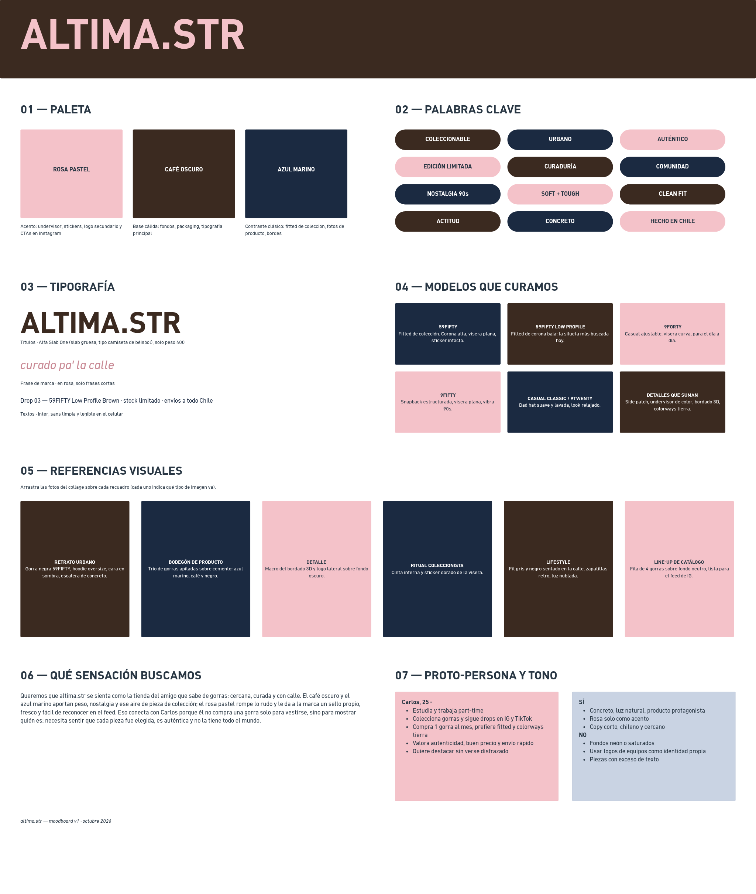

# Moodboard — altima.str

> Guía: [Moodboard](../evaluacion/guias/fase-2-specs/02-moodboard.md)

**Tablero en Whimsical:** https://whimsical.com/ignacio-galindo/moodboard-altima-str-V8fGTdawPgURYhZdcr7oYG

## Palabras clave

Coleccionable · Urbano · Auténtico · Edición limitada · Curaduría · Comunidad · Nostalgia 90s · Soft + Tough · Clean fit · Actitud · Concreto · Hecho en Chile

## Qué sensación buscamos

Queremos que altima.str se sienta como la tienda del amigo que sabe de gorras: cercana, curada y con calle.
El café oscuro y el azul marino aportan peso, nostalgia y aire de pieza de colección; el rosa pastel rompe lo rudo y le da un sello propio, fácil de reconocer en el feed.
Conecta con Carlos (25) porque él no compra una gorra solo para vestirse, sino para mostrar quién es.
Necesita sentir que cada pieza fue elegida, es original y no la tiene todo el mundo.
