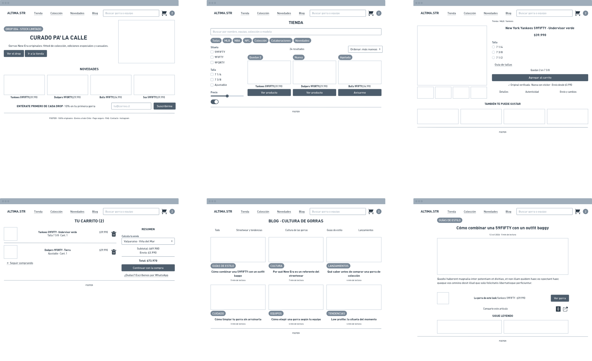

# Spec de diseño — altima.str

> Guía: [Spec de diseño](../evaluacion/guias/fase-2-specs/06-spec-de-diseno.md)

La spec de diseño tiene dos partes:

1. **[`DESIGN.md`](../DESIGN.md)** (en la raíz): tu design system, en el formato que Stitch importa.
2. **Este documento:** tus pantallas, escritas como prompts listos para pegar en Stitch.

**Wireframes en Whimsical:** https://whimsical.com/LCQkqqvPpibwsCmhdiLGbn

> Guía de wireframes: [Wireframes](../evaluacion/guias/fase-2-specs/04-wireframes.md)



## Pantallas

### 1. Landing

```text
Pantalla: Landing de altima.str, versión desktop. Usa el design system del proyecto.
Objetivo: que Carlos entienda en segundos que altima.str vende gorras New Era originales, vea el drop actual y entre a la tienda.
Componentes, de arriba hacia abajo:
1. navbar.
2. hero-drop: tag-drop "DROP 004 · STOCK LIMITADO", título "CURADO PA' LA CALLE", bajada "Gorras New Era originales: fitted de colección, ediciones especiales y casuales para el día a día.", button-primary "Ver el drop", button-secondary "Ir a la tienda", texto "Quedan 6 unidades · Envío a todo Chile" e imagen grande de una 59FIFTY a la derecha.
3. h2 "Novedades" y fila de 4 card-product: Yankees 59FIFTY Undervisor verde $39.990 (tag "Quedan 2"), Dodgers 9FORTY Tierra $29.990 (tag "Nueva"), Bulls 9FIFTY Snapback 90s $34.990, Red Sox 59FIFTY Low Profile $39.990.
4. form-newsletter: "Entérate primero de cada drop", "Lanzamientos, reposiciones y 10% en tu primera gorra.", input-field "tu@correo.cl", button-primary "Suscribirme", casilla "Acepto recibir correos de altima.str".
5. footer.
```

### 2. Tienda

```text
Pantalla: Tienda de altima.str, versión desktop. Usa el design system del proyecto.
Objetivo: que Carlos encuentre rápido una gorra de su equipo y su talla, con precio y stock a la vista.
Componentes, de arriba hacia abajo:
1. navbar.
2. h1 "Tienda" e input-field "Buscar por nombre, equipo, colección o modelo".
3. chip-filter: Todas (activo), MLB, NBA, NFL, Colección, Colaboraciones, Novedades.
4. A la izquierda, filtros: Silueta (59FIFTY, 9FIFTY, 9FORTY), Talla (7 1/4, 7 3/8, Ajustable), Precio y switch "Solo disponibles". A la derecha, "24 resultados", selector "Ordenar: más nuevas" y grilla de 3 columnas con 6 card-product: Yankees 59FIFTY $39.990 (tag-stock "Quedan 2"), Dodgers 9FORTY $29.990 (tag-drop "Nueva"), Bulls 9FIFTY $34.990 (card-product-soldout "Agotada", botón "Avisarme cuando vuelva"), Red Sox 59FIFTY $39.990, Lakers 9FIFTY $34.990, Raiders 9FORTY $29.990.
5. footer.
```

### 3. Ficha de producto

```text
Pantalla: Ficha de producto de altima.str, versión desktop. Usa el design system del proyecto.
Objetivo: que Carlos vea la gorra en detalle, confirme que es original, elija su talla y la agregue al carrito.
Componentes, de arriba hacia abajo:
1. navbar.
2. Migas "Tienda / MLB / Yankees".
3. Dos columnas. Izquierda: foto grande y 4 miniaturas (frente, side patch, undervisor, sticker). Derecha: h1 "New York Yankees 59FIFTY · Undervisor verde", precio "$39.990", selector de talla (7 1/4, 7 3/8, 7 1/2), link "Guía de tallas", tag-stock "Quedan 2 en 7 3/8", button-primary "Agregar al carrito" (disabled hasta elegir talla), badge-authentic "Original verificada", texto "Nueva con sticker · Envío desde $3.990" y pestañas Detalles, Autenticidad, Envío y cambios.
4. h2 "También te puede gustar" y fila de 4 card-product.
5. footer.
```

### 4. Carrito

```text
Pantalla: Carrito de altima.str, versión desktop. Usa el design system del proyecto.
Objetivo: que Carlos sepa cuánto va a pagar en total, con envío incluido, antes de comprar.
Componentes, de arriba hacia abajo:
1. navbar.
2. h1 "Tu carrito (2)".
3. Dos columnas. Izquierda: lista de productos con foto, nombre, talla, cantidad, precio e ícono de eliminar: Yankees 59FIFTY Undervisor verde, talla 7 3/8, $39.990; Dodgers 9FORTY Tierra, ajustable, $29.990. Debajo, link "← Seguir comprando". Derecha: cart-summary con selector "Región de Valparaíso · Viña del Mar", Subtotal $69.980, Envío $3.990, Total $73.970, button-primary "Continuar con la compra" y link "¿Dudas? Escríbenos por WhatsApp".
4. footer.
```

### 5. Blog

```text
Pantalla: Blog de altima.str, versión desktop. Usa el design system del proyecto.
Objetivo: que Carlos encuentre ideas e historias sobre gorras y streetwear que le interesen.
Componentes, de arriba hacia abajo:
1. navbar.
2. h1 "Blog · Cultura de gorras".
3. chip-filter: Todo (activo), Streetwear y tendencias, Cultura de las gorras, Guías de estilo, Lanzamientos.
4. Grilla de 3 columnas con 6 card-article: "Cómo combinar una 59FIFTY con un outfit baggy" (Guías de estilo, 5 min), "Por qué New Era es un referente del streetwear" (Cultura, 7 min), "Qué saber antes de comprar una gorra de colección" (Lanzamientos, 4 min), "Cómo limpiar tu gorra sin arruinarla" (Cuidado, 3 min), "Cómo elegir una gorra según tu equipo" (Equipos, 4 min), "Low profile: la silueta del momento" (Tendencias, 4 min).
5. footer.
```

### 6. Artículo

```text
Pantalla: Artículo del blog de altima.str, versión desktop. Usa el design system del proyecto.
Objetivo: que Carlos se inspire para armar su outfit y llegue directo a la gorra del artículo.
Componentes, de arriba hacia abajo:
1. navbar.
2. Columna central de 720px: tag-drop "Guías de estilo", h1 "Cómo combinar una 59FIFTY con un outfit baggy", "12 oct 2026 · 5 min de lectura" e imagen 16:9 de un outfit baggy con gorra.
3. Texto del artículo en body-md, con un h2 "El look: hoodie oversize, cargo y sneakers retro".
4. Bloque "La gorra de este look": foto, "Yankees 59FIFTY · Undervisor verde", $39.990 y button-primary "Ver gorra".
5. "Comparte este artículo" con íconos de copiar link e Instagram.
6. h2 "Sigue leyendo" y 2 card-article.
7. footer.
```

### Versión mobile (para cada pantalla)

```text
Genera la versión mobile (375px de ancho) de esta pantalla siguiendo la
sección Layout del design system: una sola columna con márgenes de 16px;
navbar con logo, ícono de búsqueda, carrito y menú hamburguesa; h1 de 36px;
grillas de productos en 2 columnas y de artículos en 1; filtros dentro de
un botón "Filtrar" que abre un panel; en la ficha de producto, galería
arriba y botón "Agregar al carrito" fijo abajo; en el carrito, el
cart-summary va bajo la lista de productos.
```
