# QA — altima.str

> Guía: [QA y coherencia](../evaluacion/guias/fase-3-prototipo/02-qa-y-coherencia.md)

## Prototipo en Stitch

> Guía: [Prototipo en Stitch](../evaluacion/guias/fase-3-prototipo/01-prototipo-en-stitch.md)

**Proyecto:** https://stitch.google.com/projects/15004287554006970478

<!-- Capturas exportadas desde Stitch (Export → .zip), guardadas en docs/img/. -->

| Pantalla | Desktop | Mobile |
|---|---|---|
| Landing | 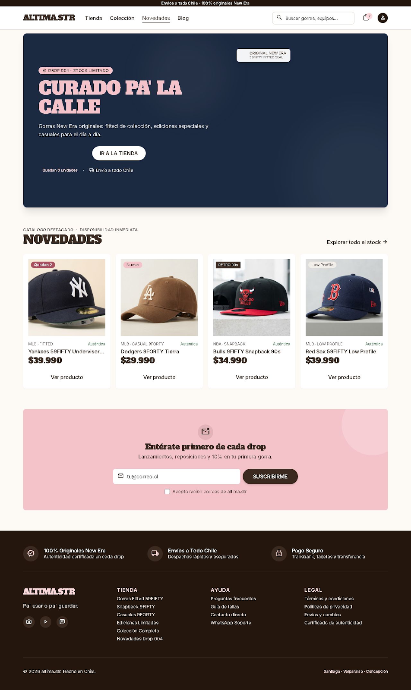 | 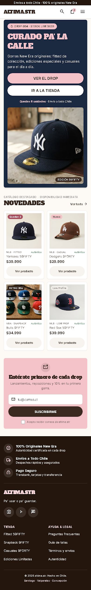 |
| Tienda | 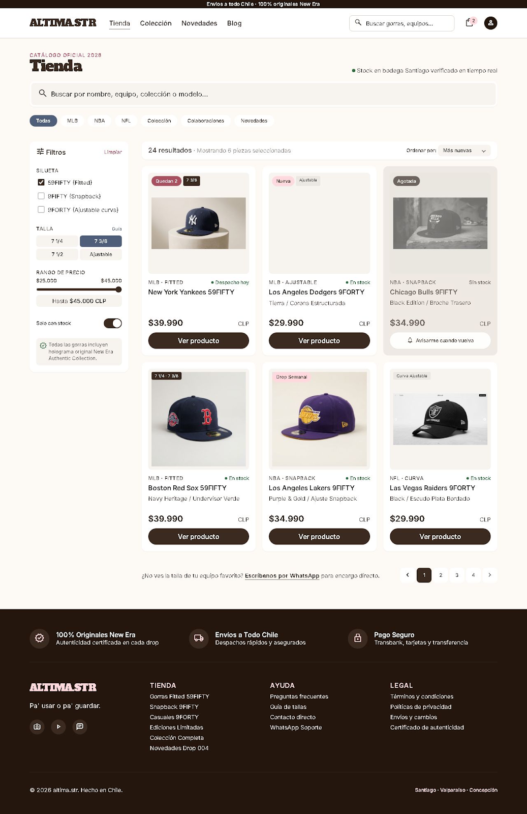 | 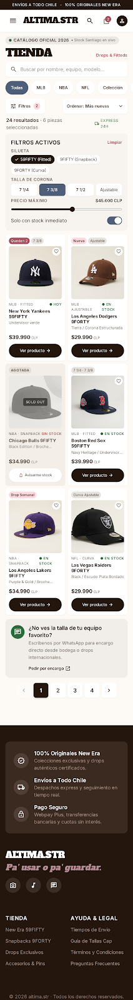 |
| Ficha de producto | 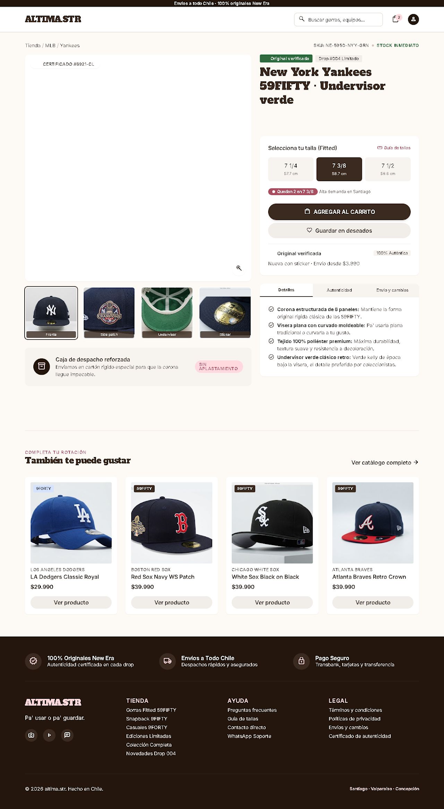 | 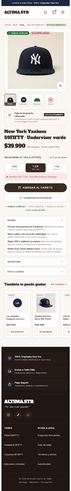 |
| Carrito | 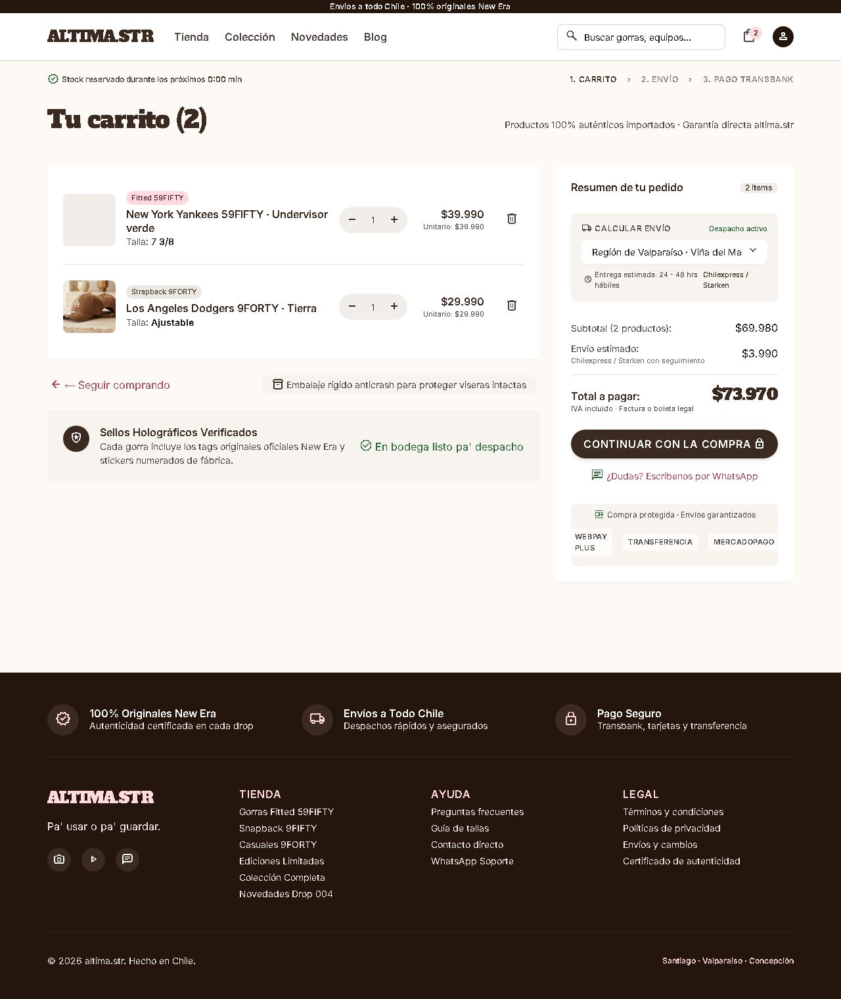 | 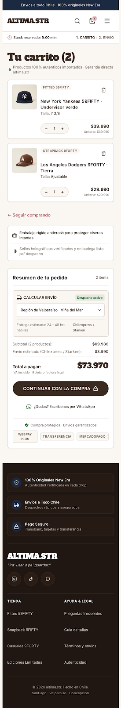 |
| Blog | 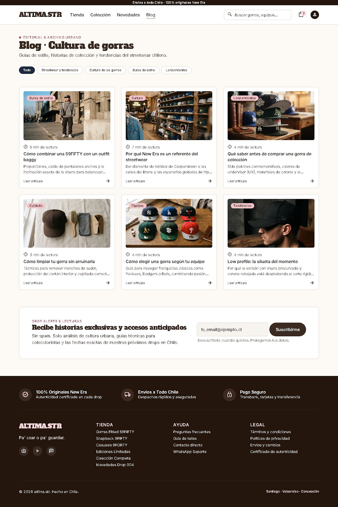 | 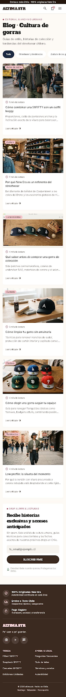 |
| Artículo | 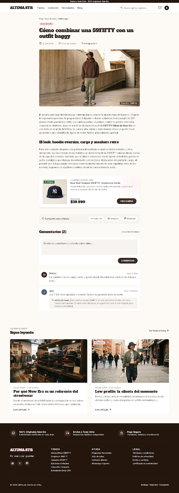 | 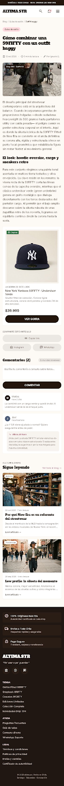 |

## Revisión: spec vs. prototipo

<!-- Una fila por diferencia. Resultado: ✅ / ❌ → ✅ / ❌ -->

| Pantalla | Qué dice la spec | Qué generó Stitch | Resultado | Corrección |
|---|---|---|---|---|
| Landing | hero-drop con tag "DROP 004 · STOCK LIMITADO", "CURADO PA' LA CALLE", "Ver el drop" e "Ir a la tienda" | Hero en azul marino con título rosa pastel, los dos botones y "Quedan 6 unidades · Envío a todo Chile" | ✅ | — |
| Landing | Fila de 4 card-product con precio y tags "Quedan 2" y "Nueva" | Las 4 gorras con precio, tags y botón "Ver producto"; además agregó etiquetas "Auténtica" y la liga (MLB · FITTED) | ✅ | Se mantienen: refuerzan la confianza en la autenticidad |
| Tienda | Filtros Silueta, Talla, Precio y switch "Solo disponibles"; "24 resultados" y orden "más nuevas" | Todos los filtros (el switch quedó como "Solo con stock"), contador y selector de orden; agregó paginación y un enlace a WhatsApp para encargos | ✅ | — |
| Tienda | Bulls 9FIFTY como card-product-soldout "Agotada" con "Avisarme cuando vuelva" | Card en gris con tag "Agotada" y botón "Avisarme cuando vuelva" | ✅ | — |
| Tienda (mobile) | Filtros dentro de un botón "Filtrar" que abre un panel | Botón "Filtros (2)", pero el panel de filtros aparece abierto sobre la grilla | ❌ | Pendiente: pedir a Stitch el panel cerrado. Lo agregué al prompt mobile |
| Ficha | Foto grande y 4 miniaturas; precio "$39.990" bajo el h1 | Las miniaturas salen bien, pero la foto principal queda vacía y el precio no se ve bajo el título | ❌ | Pendiente: regenerar con el prompt corregido (foto principal y precio explícitos) |
| Ficha | "Agregar al carrito" disabled hasta elegir talla | La talla 7 3/8 viene preseleccionada y el botón activo | ❌ | Ajusté el prompt: ninguna talla preseleccionada |
| Ficha | badge-authentic "Original verificada" y pestañas Detalles, Autenticidad, Envío y cambios | Badge, certificado y las 3 pestañas; agregó guía de tallas en cm y "Guardar en deseados" | ✅ | — |
| Ficha (mobile) | Galería arriba y "Agregar al carrito" fijo abajo | Galería arriba, pero el botón queda dentro del contenido (solo la navbar es fija) | ❌ | Agregué "sticky bottom" al prompt mobile |
| Ficha (mobile) | Mismos textos que desktop | En "Envío y cambios" dice 30 días para cambios; en desktop dice 10 días | ❌ | Pendiente: dejar un solo plazo. Agregué "mantén los mismos textos" al prompt mobile |
| Carrito | Lista con 2 gorras, cart-summary con región, Subtotal $69.980, Envío $3.990, Total $73.970 | Todo correcto; agregó un contador de stock reservado, pasos Carrito › Envío › Pago y sellos de Webpay, transferencia y MercadoPago | ✅ | — |
| Carrito (mobile) | cart-summary bajo la lista de productos | Resumen bajo la lista, con el botón "Continuar con la compra" ancho completo | ✅ | — |
| Blog | chip-filter con 5 categorías y 6 card-article con categoría y minutos de lectura | Los 6 artículos y los chips; agregó un bloque de newsletter "Drop Alerts" que no estaba en la spec | ✅ | Se mantiene el newsletter: es la funcionalidad "recibir novedades" de la Fase 1 |
| Artículo | Columna de 720px, bloque "La gorra de este look", comentarios de Matías y Javi, 2 artículos en "Sigue leyendo" | Todo presente; agregó WhatsApp a "Comparte este artículo" y una respuesta de altima.str a Javi | ✅ | — |
| Todas (mobile) | Navbar igual en todas: logo, búsqueda, carrito y menú hamburguesa | Cabeceras distintas entre pantallas | ❌ → ✅ | Le pedí a Stitch una navbar compacta compartida (logo en Alfa Slab One, lupa, carrito con badge y hamburguesa) |
| Tienda (mobile) | Navbar igual al resto | Menú hamburguesa a la izquierda e ícono de usuario extra | ❌ | Pendiente: aplicar la misma navbar. El prompt mobile ahora la describe con orden exacto |
| Ficha (desktop) | navbar con los enlaces Tienda, Colección, Novedades, Blog | Navbar sin los enlaces de navegación | ❌ | Pendiente: copiar la navbar de las demás pantallas desktop |
| Todas | footer en azul marino (`secondary` #1B2A41) | Footer en café muy oscuro (#201712), que no es un token del DESIGN.md | ❌ | Pendiente: decidir entre volver al azul marino o actualizar el DESIGN.md |

## Mejoras a mis specs

<!-- Qué cambiaste en DESIGN.md o en tus prompts después de ver el resultado. -->

- En el prompt de la **ficha de producto** (`09-spec-diseno.md`) pedí explícitamente la foto principal de la gorra de frente ("el contenedor nunca queda vacío") y el precio en `headline-md` justo bajo el h1. Stitch los había omitido.
- En el mismo prompt cambié "disabled hasta elegir talla" por "**disabled y ninguna talla preseleccionada**": Stitch interpretaba que podía dejar una talla elegida.
- En el **prompt mobile** describí la navbar con el orden exacto (logo a la izquierda; búsqueda, carrito con badge y hamburguesa a la derecha; sin ícono de usuario), porque cada pantalla salía con una cabecera distinta.
- En el prompt mobile agregué que el **panel de filtros empieza cerrado**, que el botón "Agregar al carrito" es **sticky bottom** y que el **footer** es igual en todas las pantallas.
- Agregué al prompt mobile "**mantén los mismos textos, precios y condiciones de la versión desktop**", porque Stitch inventó un plazo de cambio distinto en la ficha mobile.

## User flows

| Flujo | Recorrido en el prototipo | ¿Se completa? |
|---|---|---|
| Compra | Landing → [Ir a la tienda] → Tienda → chips y filtros → [Ver producto] → Ficha → elegir talla → [Agregar al carrito] → Carrito → [Continuar con la compra] | ✅ Hasta el carrito. El pago y la confirmación quedan fuera del prototipo, como anoté en la arquitectura |
| Contenido | Landing → [Blog] en la navbar → Blog → chip "Guías de estilo" → [Leer artículo] → Artículo → [Ver gorra] → Ficha de la Yankees 59FIFTY | ✅ |

## Coherencia

<!-- 5 a 10 líneas: cómo responde el prototipo al brief y a tu proto-persona,
y qué cambió desde la Fase 1 y por qué. -->

El objetivo del brief es vender gorras New Era online con un catálogo ordenado, y el prototipo lleva desde la landing hasta el carrito en cuatro clics. A Carlos le frustra tener que preguntar por mensaje el precio, el stock y el envío: el prototipo muestra el precio y el stock en cada card ("Quedan 2", "Agotada · Avisarme"), y el carrito calcula el envío por región antes de pagar. Para su desconfianza sobre la autenticidad están el badge "Original verificada", la pestaña Autenticidad y los sellos del footer. Como busca modelos distintos, la tienda tiene chips de Colección y Colaboraciones y el drop actual está en el hero. Como compra desde el celular, todas las pantallas tienen versión mobile con navbar compacta y carrito siempre visible. El blog le da ideas de outfits y lo lleva directo a la gorra del look.

Lo que cambió desde la Fase 1: el sitio, que partía de las redes sociales, ahora vende directo, pero mantiene WhatsApp e Instagram como apoyo para dudas y encargos. El newsletter que Stitch agregó al blog se quedó porque cumple la funcionalidad "recibir novedades" que definimos. Tras el QA, la mayor parte de lo pendiente es de consistencia mobile y de la ficha, y ya está corregido en los prompts para la próxima generación.
